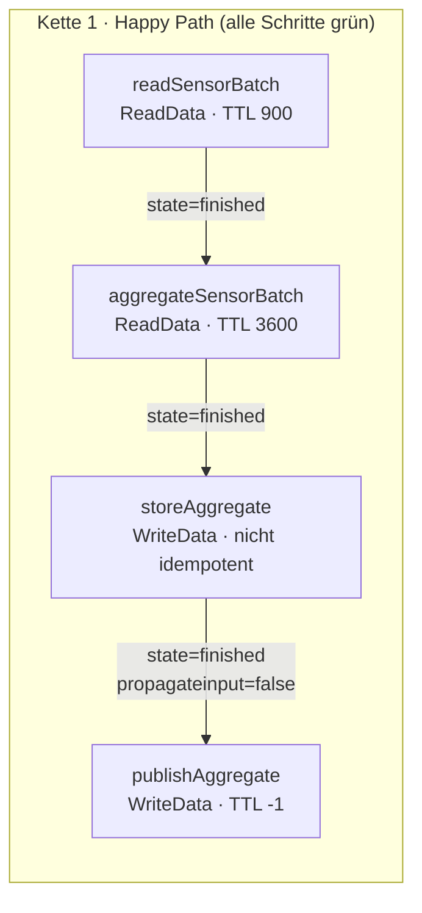
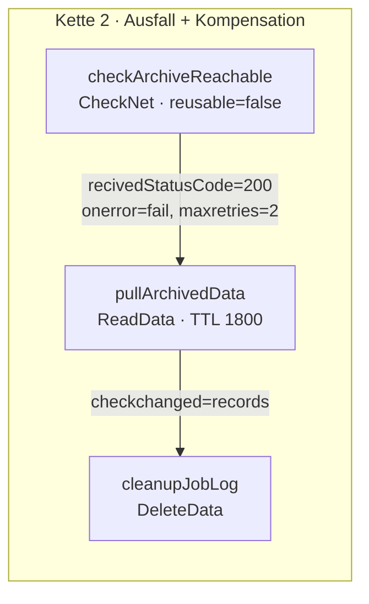
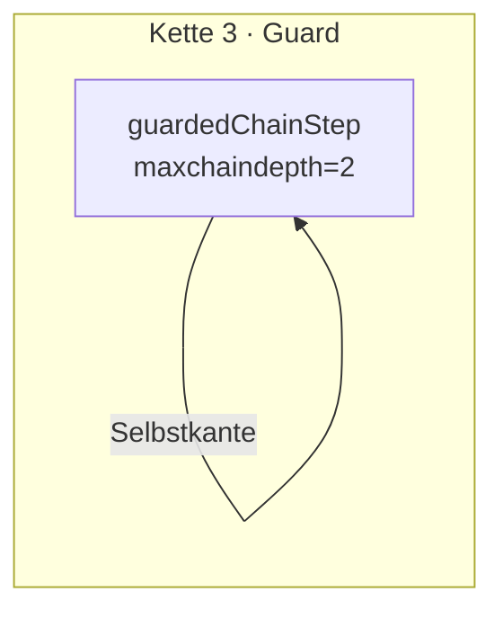
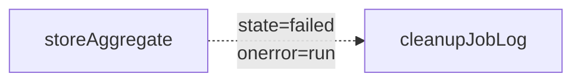

# Wochenbericht — Chain-/Replay-Handling in SmartDataJobs

**Zeitraum:** 2026-11-24 … 2026-11-26
**Repos:** `SmartDataDeployment` (Deployment, Schema-Migration, Demo-Daten) · `SmartDataJobs` (Runner, Datenmodell) · `SmartMonitoringFrontend` (Job-Liste)
**Status:** Schema + Runner + Replay-Plan live verifiziert. Replay-*Ausführung* bewusst noch nicht gebaut.
Diagramme: Syntax mit `mermaid.parse()` (mermaid 11) geprüft — nicht gerendert (kein Browser auf der Maschine).

---

## 1. Problem in einem Satz

Eine Job-Chain war „fire-and-forget": nichts in `datajobs_log` sagte, **welcher Lauf** welchen Nachfolger ausgelöst hat und **welche Eingaben** er benutzt hat — „ab dem fehlgeschlagenen Job fortsetzen" war damit Raten über die zwei neuesten Log-Zeilen.

## 2. Was umgesetzt wurde

| Bereich | Änderung |
|---|---|
| **Run-Identität** | Neue Spalten `runid`, `chainrunid`, `parentrunid`, `step`, `attempt` — jeder Lauf ist identifizierbar, jeder Chain-Lauf hat einen Root-Lauf |
| **Lineage** | Nachfolger erbt `chainrunid`, `parentrunid` zeigt auf den auslösenden Lauf, `step` zählt mit |
| **Input-Snapshot** | `input` (Params + `preJobsInfo`) und `inputhash` (SHA-256) werden pro Lauf persistiert |
| **Zustandsnormalisierung** | `runstate` (`scheduled/running/finished/failed/error/timeout/stopped/skipped/replayed`) + `errorclass` (`network/http_4xx/http_5xx/timeout/exec/misconfigured/dependency/internal`) |
| **Result-TTL** | `resultttlsecs`, `resultttlbasis`, `resultscope`, `reusable`, `idempotent`, `maxchaindepth` auf `datajobs`; `resultvaliduntil` materialisiert pro Lauf |
| **Edge-Policy** | `onerror` (`skip`/`run`/`fail`), `propagateinput`, `reuseallowed`, `maxageresultsecs`, `maxretries`, `retrydelaysecs` auf `datajobs_chain` |
| **Replay-Plan** | `GET /jobexecution/replay?chainrunid=…&fromrunid=…&dryrun=true` liefert Resume-Point + pro Schritt `skip`/`re-execute` (read-only) |

### Bugs, die dabei mit behoben wurden

- `checkChanged()` verglich gegen die **zweitneueste** Log-Zeile → jetzt exakt gegen `parentrunid`
- fehlender `checkkey` im Result war ein **stiller No-op** → wird jetzt gemeldet
- `paramError` wurde pro Parameter überschrieben → `paramErrors[]` mit allen Diagnosen
- `saveResultLog()` im `catch` konnte wiederholende Jobs **absterben** lassen → abgefangen
- `SmartDataAccessor.saveRunLog()` schrieb hart ins Schema `smartmonitoring` → nutzt jetzt den konfigurierten Storage

### Commits

```
f807541  Add replay/run bookkeeping: run ids, lineage, input snapshots, onerror, replay plan   (SmartDataJobs)
6190fd0  Classify errorclass from recivedStatusCode too (CheckNet)                            (SmartDataJobs)
6506cfa  feat: replay/run bookkeeping for SmartDataJobs (schema + runner + plan)              (SmartDataDeployment)
1ad6a53  add state of chains  → weekly-2026-11-26-replay-fields.md / -summary.md             (SmartDataDeployment)
```

`DBChanges/AddReplayFields.sql` (101 Zeilen, idempotent, mit Backfill bestehender Zeilen) ist am 2026-11-25 gegen `frodermann.me/smartmonitoring_test` gelaufen.

### Begleitende Dokumente

| Dokument | Inhalt |
|---|---|
| [`weekly-2026-11-26-replay-fields.md`](weekly-2026-11-26-replay-fields.md) | vollständiger Entwurf: Feldbegründung, verworfene Alternativen, Replay-Semantik, TTL-Basis, offene Fragen |
| [`weekly-2026-11-26-replay-fields-summary.md`](weekly-2026-11-26-replay-fields-summary.md) | Kurzfassung davon |
| dieses Dokument | was davon umgesetzt wurde, Demo-Daten, Vorbehalte |

## 3. Demo-Daten

Ziel: die neuen Felder *und* die neuen Entscheidungspfade sichtbar machen, ohne dass irgendetwas feuert.

```bash
python3 scripts/demo_jobs_data.py            # installieren / neu installieren
python3 scripts/demo_jobs_data.py --dryrun   # nur zeigen
python3 scripts/demo_jobs_data.py --remove    # nur die Demo-Zeilen löschen
```

Reproduzierbar: feste UUID-Namespace + fester UTC-Anker ⇒ gleiche Run-IDs bei jedem Reinstall.
**8 Jobs** (`active=false`), **7 Kettenglieder**, **16 Läufe in 7 Chain-Runs**.

### Die vier Ketten







Die vierte Beziehung — `storeAggregate → cleanupJobLog` mit `onerror=run` — ist der Kompensationspfad aus Kette 1 und bewusst als Diagonale gezeichnet:



### Die 7 Chain-Runs

| # | Root | Schritte | Was sie zeigen |
|---|---|---|---|
| **A** | `readSensorBatch` | 4 × `finished` | vollständiger Lauf → Plan: *nothing to resume* |
| **B** + **C** | `readSensorBatch` | `finished`, `finished`, **`failed`**, dann `timeout` (`attempt=2`, `replayofrunid`) | Resume-Point bei Schritt 2; Replay desselben Chain-Runs inkl. Grund |
| **D** | `checkArchiveReachable` | **`failed`** | `onerror=fail` stoppt den Chain-Run, nichts folgt |
| **E** | `checkArchiveReachable` | 3 × `finished` | erholter Pfad bis `cleanupJobLog` |
| **F** | `guardedChainStep` | 1 × `finished` | `maxchaindepth` kappt die Selbstkante |
| **G** | `cleanupJobLog` | 1 × `finished` | Root-Lauf ohne Chain (`chainrunid == runid`) |
| **H** | `readSensorBatch` | 2 × `finished`, **TTL abgelaufen** | `resultvaliduntil` in der Vergangenheit ⇒ Resume darf nicht skippen |

Zusätzlich in den Läufen: `resultreused=true` + `inputfromrunid` (Ergebnis wiederverwendet statt neu ausgeführt), `errorclass` (`http_5xx`, `timeout`), `durationms`.

### Live-Ausgabe des Replay-Plans

```console
$ curl '.../jobexecution/replay?storage=smartmonitoring&chainrunid=f457420b-…'
 step 0  job 58  finished  -> skip
 step 1  job 59  finished  -> skip
 step 2  job 60  failed    -> re-execute
 step 2  job 60  timeout   -> re-execute
```

---

## 4. Vorbehalt: Warnung in der Frontend-Job-Liste

> „Einige Beziehungen sind ungültig oder verweisen auf fehlende Zeilen."

**Das ist die Demo-Daten-Form, kein Fehler.** Verifiziert mit der Plugin-Funktion selbst (`buildHierarchy()`):

| Datenlage | Meldung |
|---|---|
| nur die ursprünglichen Airquality-Edges | *(keine)* |
| + Diagonale `60→64` | `ambiguous` |
| + Selbstkante `65→65` | `cycle` |

`TableHierarchy` baut aus **allen** aktiven Kanten einen Baum; ein Knoten mit zwei Nachfolgern (die Kompensation) und eine Selbstkante sind aber kein Baum. Die neuen Spalten wertet das Frontend gar nicht aus. Die Zeilen bleiben sichtbar, die Meldung ist rein kosmetisch.

Zwei Optionen: so lassen und als bewusste DAG-Demo dokumentieren, oder die zwei baumbrechenden Kanten entfernen (Felder und alle 16 Läufe bleiben unverändert).

## 5. Transport-Hinweis: Läufe gehen nicht über REST

- **Job-Definitionen** (Jobs, Params, Kanten, Objekt-Verknüpfungen) laufen über die normalen SmartData-REST-Routen — genau wie die Admin-Setup-Seite.
- **Läufe** (`datajobs_log`) werden per `psql` eingespielt, aus zwei Gründen:
  1. Es gibt keine REST-Route „führe Job X aus und verbuche Ergebnis Y zu Zeit T" — Läufe entstehen nur durch echte Ausführung, die die Actions auslösen und den Log zeitabhängig machen würde.
  2. **SmartData kann `uuid`-Spalten nicht über REST schreiben.** `DynRecordsPostgres.setPlaceholder()` hat keinen `uuid`-Fall ⇒ der Platzhalter wird nie gebunden ⇒ jeder Insert scheitert mit `No value specified for parameter N` (an einer Wegwerftabelle reproduziert). Da `runid`/`chainrunid`/`parentrunid`/`replayofrunid` alle `uuid` sind, ist `datajobs_log` über REST grundsätzlich nicht beschreibbar. → Kandidat für einen eigenen Fix in SmartData.

## 6. Nächste Schritte

- **Replay-Ausführung** (bisher nur `dryrun`): Lauf neu anlegen, `replay_of_run_id` setzen, Input aus dem Snapshot statt neu herleiten.
- **Result-Reuse** verdrahten: `reusable`/`resultttlsecs`/`resultscope` + `reuseallowed` werden geschrieben, aber noch nicht ausgewertet.
- `maxretries`/`retrydelaysecs` und der Idempotenz-`force`-Guard am Endpoint.
- Admin-UI: Diff „Params damals vs. jetzt" vor dem Replay.
- `SmartData`: `uuid`-Unterstützung für REST-Inserts (blockiert nebenbei jede Run-Buchführung über die API).
