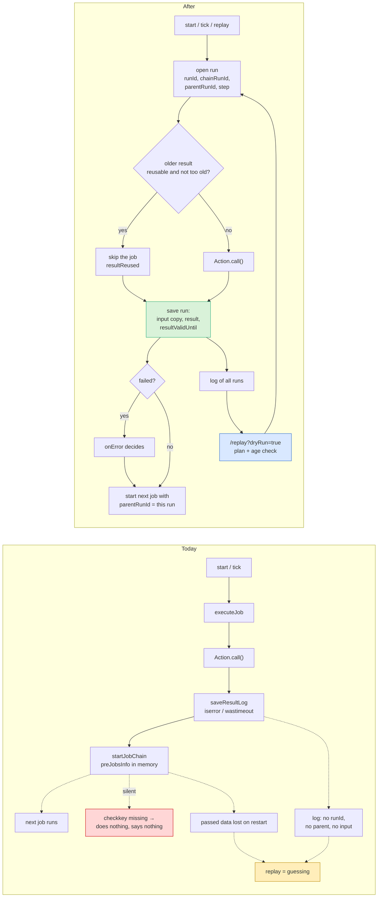

# Job replay & result TTL — summary

Short version of [`weekly-2026-11-26-replay-fields.md`](weekly-2026-11-26-replay-fields.md) (that one has the full reasoning, the list of existing bugs and the open questions).
The state of the implementation is described in [`weekly-2026-11-26-chain-replay.md`](weekly-2026-11-26-chain-replay.md).

---

## The problem

A chain just runs and forgets. Resuming after a failed job means guessing, because:

- `datajobs_log` has no **run id** — two runs of the same job at the same time look the same.
- A log row does not say **which run started it**.
- `preJobsInfo` (the data passed to the next job) is kept **only in memory**; a restart or a failure loses it.
- There is no **saved copy of the input** — replaying `ReadData` a day later reads *today's* data.
- Nothing decides whether a finished result **can still be used**.

Main rule: **a replay must repeat the inputs of the failed run, not read new ones.**

Two things that are easy to mix up, and must stay apart:

- a **run** = one execution of one job (roughly one `datajobs_log` row).
- a **chainRun** = one pass through the chain, which contains many runs.

A replay goes into one `chainRun` and restarts at one failed `run`.

---

## New fields

### `datajobs` — settings only

| Field | Type | Default | Why |
|---|---|---|---|
| `idempotent` | bool | `false` | The action may safely run twice. If false, a replay needs `force`. |
| `maxChainDepth` | int4 | `0` | Stops endless loops. `0` = no limit (like today). |
| `reusable` | bool | `false` | May a finished result be used again? Off by default, which is the safe choice. |
| `resultTtlSecs` | int4 | `0` | How long a result may be used. `0` = never, `-1` = forever. |
| `resultTtlBasis` | varchar(16) | `wallclock` | `wallclock` \| `schedule` \| `dataTime` — what counts as the age. |
| `resultScope` | varchar(32) | `chainRun` | Who may use it: `chainRun` \| `job` \| `global`. |

No run state here — that belongs to a single run, not to the job definition that all runs share.

### `datajobs_log` — now also the record of what happened

| Field | Type | Why |
|---|---|---|
| `runId` | uuid | Id of this one attempt. Created by the runner, not by the database. |
| `chainRunId` | uuid | Which pass through the chain. Same as `runId` for the first job. |
| `parentRunId` | uuid | The run that started this one. Gives the full history at any depth. |
| `step` | int4 | Where in the chain (first job = 0). |
| `runState` | varchar(32) | Fixed set of words: `scheduled`\|`running`\|`finished`\|`failed`\|`error`\|`timeout`\|`stopped`\|`skipped`\|`replayed`. Replaces reading the free text in `result.state`. |
| `input` + `inputHash` | text / varchar(64) | Saved copy of the input that was really used. **The one field that cannot be added later** — old runs would stay empty. |
| `errorClass` | varchar(64) | `network`\|`http_4xx`\|`http_5xx`\|`timeout`\|`exec`\|`misconfigured`\|`dependency`\|`internal`. |
| `attempt` | int4 | Which attempt this is for this job in this chainRun. |
| `replayOfRunId` | uuid | Set when the run is a replay; shows "this was already retried". |
| `resultValidUntil` | timestamptz | `ts + resultTtlSecs`, written once when the run is saved. Then "too old?" is a single indexed comparison. |
| `resultReused` | bool | The input came from an older result instead of from running the job. |
| `inputFromRunId` | uuid | *Which* run's result was used. |
| `durationMs` | int4 | Helps spot jobs that behave differently from run to run. |

### `datajobs_chain` — settings for one link between two jobs

| Field | Type | Default | Why |
|---|---|---|---|
| `onError` | varchar(16) | `skip` | What to do when the job before it failed: `skip` \| `run` (start a cleanup job) \| `fail` (stop the chain). |

`datajobs_params` stays as it is. But since params are read fresh every run, a change to them quietly changes what a replay would use. So show a diff before replaying.

---

## Replay

```
POST /jobexecution/replay?chainRunId=…&fromRunId=…&dryRun=true&force=false
```

1. Load all runs of the `chainRunId`, ordered by `step`.
2. Start point = `fromRunId`, or the first run that is not `finished`/`replayed`.
3. Plan: run the start point again, plus every later run that is not `finished`. Leave the rest alone, unless `force`.
4. Checks (they stop the replay unless `force`): the job is `active`, the job is not running right now, `idempotent` is true or `force` is set, `step <= maxChainDepth`.
5. Run it with a **new** `runId`, with `replayOfRunId` set, the same `chainRunId`/`parentRunId`/`step`, and the input taken **from the saved copy**.
6. Continue the chain, but only with the runs that are in the plan.

`dryRun` returns the plan and a diff of saved input vs. current params. It only reads, changes nothing, and is useful right away.

**Running exactly once is not possible.** `WriteData` sends a request to another system. If it fails *after* that system already saved the data, a replay sends it twice. `idempotent` is a statement by the person who set the job up; the API must never claim more than that. (The Airquality chain happens to be safe anyway, because `syncedField` only marks records as synced after a 2xx answer.)

---

## Reusing results and TTL

Whether a result may be reused depends on the **action**. For how long it may be reused depends on the **job**.

| Action | May be reused | Why |
|---|---|---|
| `ReadData` | for a limited time | Fine until the source data changes. |
| `CheckNet`, `CheckEventTriggers` | no | Only true for one moment. "Was reachable 1 h ago" tells you nothing now. |
| `CommandExecution` | limited time / never | A sensor reading is out of date in seconds; a measurement id may stay the same for hours. Must be set per job. |
| `WriteData`, `Mail`, `SendNotification` | yes | The action already happened. Reusing its result is the *only* safe way to replay. |
| `DeleteData` | keep the result | Reusing is fine; running it again deletes things. |
| `CreateFlagFile` | no | The file may have changed since. |

The check, working backwards from the start point:

```
if run.runState == finished
   and action may be reused and job.reusable
   and job.resultScope allows this chainRun
   and edge.reuseAllowed
   and (resultValidUntil is null or now() <= resultValidUntil)
then skip the job, pass its saved result on, set inputFromRunId
else run the job again first — the start point moves forward
```

What the age is measured from matters — pick one on purpose:

- `wallclock` — time since the run. Simplest, and what people usually mean.
- `schedule` — one `repeatSecs`. Stops a chain that stalled from using old data long after.
- `dataTime` — the newest timestamp inside the data. Most exact for sensors.

One consequence: if the result before the start point is too old, the replay has to run **more** jobs than just the failed one. That must show up in the `dryRun` plan, not be found out in the middle of a replay.

### What not to do

- Don't set the TTL of a `WriteData` result to forever just because it worked. The other system may have undone it.
- Don't use `checkChanged` as a TTL. "Did the value change?" is not the same as "is the value still OK to use?".
- Don't reuse results across different `chainRunId`s by default. That turns a chain into a cache, and a cache without cleanup causes bugs.
- Don't put the TTL into `repeatSecs`. The schedule says how often you want to run; the TTL says how long the data stays usable. Those are different things.

---

## Today vs. after the change



| Question | Today | After |
|---|---|---|
| Which run do I replay? | cannot tell | `runId`, `chainRunId`, `step` |
| What did the job before pass on? | in memory, lost | `input` copy |
| Which run started which? | nothing recorded | `parentRunId` |
| Can a finished result still be used? | never asked, used anyway | `reusable`, `resultTtlSecs`, `resultValidUntil` |
| Why did the next job not start? | sometimes nothing said | always a `skipped` run with a reason |

---

### Other Bugs

1. `checkChanged()` compares log `row[1]` and assumes `row[0]` is the current run. This breaks with runs that overlap or with a replay in between.
2. `startJobChain()` does nothing when `checkkey` is missing from the result (no `else` branch). A replay will look like "it just does not resume".
3. `checkValue` is compared as text, so numbers and booleans only match if they are written the same way.
4. Only the *last* `paramError` survives in the result, so a replayed setup error looks the same as the first time.
5. Job 17 deletes `datajobs_log` rows after 14 days. That will silently delete the saved inputs too.

---

## Side by side: the tables


### Today

```
datajobs                    -- job settings, shared by all runs
  id           bigserial    PK
  name         varchar(255)
  "desc"       varchar(255)          -- quoted: a reserved word in PostgreSQL
  action       varchar(255)          -- CommandExecution | ReadData | WriteData | ...
  active       bool
  start        timestamp             -- first execution
  stop         timestamp             -- self-stop after this
  repeatsecs   int4                  -- 0 = once, >0 = every N seconds
  priority     int4

  + idempotent     bool        false   -- action may safely run twice
  + reusable       bool        false   -- a finished result may be used again
  + resultttlsecs  int4        0       -- 0 = never, -1 = forever
  + resultttlbasis varchar(16) wallclock  -- wallclock | schedule | dataTime
  + resultscope    varchar(32) chainRun   -- chainRun | job | global
  + maxchaindepth  int4        0       -- 0 = no limit (like today)
```

```
datajobs_log                -- one row per run; today this is all we know
  id           bigserial    PK
  datajob_id   int8         NOT NULL  -> datajobs.id
  result       text                   -- the action's answer, as text
  ts           timestamp    NOT NULL default now()
  iserror      bool
  wastimeout   bool
  processed    bool                   -- eaten by the aggregation job

  + runid            uuid         -- this attempt. Created by the runner
  + chainrunid       uuid         -- which pass through the chain
  + parentrunid      uuid         -- the run that started this one
  + step             int4    0    -- position in the pass (first job = 0)
  + runstate         varchar(32)  -- scheduled|running|finished|failed|error|
                                  -- timeout|stopped|skipped|replayed
  + input            text         -- copy of the input actually used  <<< cannot be added later
  + inputhash        varchar(64)
  + errorclass       varchar(64)  -- network|http_4xx|http_5xx|timeout|exec|
                                  -- misconfigured|dependency|internal
  + attempt          int4    1
  + replayofrunid    uuid         -- set on replays
  + resultvaliduntil timestamptz  -- ts + resultttlsecs, written once on save
  + resultreused     bool    false
  + inputfromrunid   uuid         -- which run's result was used
  + durationms       int4

  indexes: (chainrunid, step) | (runid) | (parentrunid)
           (resultvaliduntil) WHERE resultvaliduntil IS NOT NULL
```

```
datajobs_chain              -- one row per link between two jobs
  id           bigserial    PK
  pre_job_id   int8         NOT NULL  -> datajobs.id
  post_job_id  int8         NOT NULL  -> datajobs.id
  checkkey     varchar(255)
  checkvalue   varchar(255)
  checkchanged varchar(255)
  active       bool

  + onerror          varchar(16) 'skip'  -- skip | run (cleanup job) | fail
  + reuseallowed     bool        false   -- may this link use an older result?
  + maxageresultsecs int4        NULL    -- per-link override, NULL = take job's
  + propagateinput   bool        true    -- pass the previous result on?
  + maxretries       int4        0
  + retrydelaysecs   int4        0
```

Old rows: each gets its own `chainrunid`, because nobody knows which pass it belonged to — guessing would be worse than saying "unknown". `resultvaliduntil` stays `NULL` (never expires), but `reusable` on the job defaults to `false`, so they are not used anyway.

`datajobs_params` and `datajobs_join_oo` stay exactly as they are. Only thing to watch: `datajobs_params` is read fresh on every run, so a change there alters what a replay would use — hence the diff in the `dryRun` plan.

### What the tables hold, in rows

One failed upload, first today, then after the change:

```sql
-- TODAY: which run failed? when? no way to tell which pass it was part of.
SELECT id, datajob_id, ts, iserror, wastimeout, result
  FROM smartmonitoring.datajobs_log
 WHERE iserror;
--  id | datajob_id |          ts         | iserror | wastimeout | result
-- ----+------------+---------------------+---------+------------+-------------------
--  93 |          7 | 2026-11-23 04:12:09 | t       | f          | {"state":"failed",...

-- TODAY: what did job 7 send? nothing saved. Only the answer is in result.
-- TODAY: what did job 9 hand to job 7? gone when the server restarted.
-- TODAY: can this be replayed? nobody can say.
```

```sql
-- AFTER: the same failure, with everything a replay needs
SELECT runid, chainrunid, parentrunid, step, datajob_id,
       runstate, errorclass, attempt, resultvaliduntil, durationms
  FROM smartmonitoring.datajobs_log
 WHERE chainrunid = 'b32e0000-0000-0000-0000-000000000001'
 ORDER BY step;

--  step | datajob_id | runstate | errorclass | attempt |    resultvaliduntil    | durationms
-- ------+------------+----------+------------+---------+------------------------+------------
--     0 |          9 | finished |            |       1 | 2026-11-23 04:14:00+00 |        210
--     1 |          7 | failed   | http_5xx   |       1 |                        |       5002

-- The plan for a dry run: start at step 1 again
SELECT step, datajob_id, runstate
  FROM smartmonitoring.datajobs_log
 WHERE chainrunid = 'b32e0000-0000-0000-0000-000000000001'
   AND step >= 1
 ORDER BY step;

-- Was that job already replayed?
SELECT count(*) FROM smartmonitoring.datajobs_log
 WHERE replayofrunid = 'c7000000-0000-0000-0000-000000000002';
```
