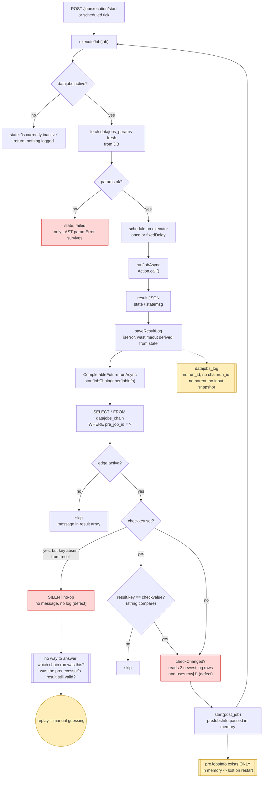
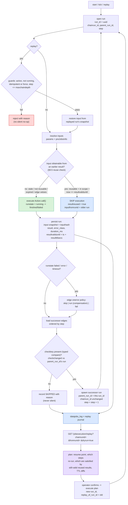

# Job & Chain fields needed for replaying (resume from a failed job)

Status: **proposal for the week of 2026-11-23**. This is the state at the time of writing; the implementation has since landed (see [`weekly-2026-11-26-chain-replay.md`](weekly-2026-11-26-chain-replay.md)).
Scope: `SmartDataJobs` — `datajobs`, `datajobs_chain`, `datajobs_log`, `datajobs_params`.

---

## 1. Problem statement

Today a job chain is *fire-and-forget*. Everything that decides whether a chain continues
is derived on the fly from the **latest log rows**, and nothing records *which* run of a
job triggered *which* downstream job.

Concretely, "resume a chain from a failed job" currently means:

1. look at `datajobs_log` for `iserror = true` rows,
2. guess which chain run they belonged to,
3. find out which successor jobs never ran,
4. manually `POST /jobexecution/start?id=<post_job_id>` for each one.

That is unreliable because of five structural gaps:

| # | Gap | Where |
|---|---|---|
| G1 | No run/attempt identity. `datajobs_log` rows of two overlapping runs of the same job are indistinguishable. | `datajobs_log`, `saveResultLog()` |
| G2 | No lineage. A log row does not say "I am step 2 of chain run X, triggered by log row Y". | `startJobChain()` discards the parent log id |
| G3 | The payload handed to the next job (`preJobsInfo`) is **not persisted**. After a failure it only exists as `datajobs_log.result` text, and chains of depth ≥ 3 lose everything before the immediate predecessor. | `runJobAsync()`, `Action.setPreJobsInfo()` |
| G4 | No input snapshot. If you replay a `ReadData` job a day later, it reads *today's* data, not the failed run's data. | actions have no `input` record |
| G5 | No replay bookkeeping. Nothing marks a run as replayed, nothing stops a replay from being replayed, chains have no depth/loop guards. | — |

A secondary blocker: **not every action is safe to replay.** `WriteData` is a POST to a
foreign system; replaying it after a *partial* failure duplicates writes (see §5.3).

---

## 2. Design principle

> A replay must reproduce the **inputs of the failed run**, not re-derive them.

That single rule decides almost every field below: to reproduce inputs we need to have
recorded them (input snapshot), and to know *where* to resume we need lineage and run
identity.

Two levels are needed, and they must not be conflated:

* **run** — one execution attempt of one job (what `datajobs_log` row is today, extended).
* **chain run** — one logical traversal of the chain graph, started by one root job
  execution; a chain run contains many runs. Replay operates on a **chain run**,
  resuming from one failed **run** inside it.

---

## 3. New/changed fields per table

### 3.1 `datajobs` (definition — mostly unchanged)

The job definition is a *template*; replay state must not live here. Only two additions are
genuinely per-definition:

| New field | Type | Default | Purpose |
|---|---|---|---|
| `maxchaindepth` | int4 | `0` | Guard against A→A / long cycles when replaying or chaining. `0` = unlimited (current behaviour). |
| `idempotent` | bool | `false` | Declares "this action may safely run twice with the same input". `false` ⇒ replay requires an explicit `force` and is refused by default (§5.3). |

`datajobs` deliberately gets **no** `lastrunid` / `state` column: it is shared by all
runs, and writing run state into the definition is what makes the current `/states`
output depend on in-memory `futures`.

### 3.2 `datajobs_log` (execution record — the core change)

Rename mentally to "run". Existing columns stay (`id`, `datajob_id`, `result`, `ts`,
`iserror`, `wastimeout`, `processed`). Additions:

| New field | Type | Purpose |
|---|---|---|
| `run_id` | uuid | Identity of this single attempt. Primary handle for replay. |
| `chainrun_id` | uuid | Identity of the logical chain traversal this run belongs to. Equals `run_id` for a root job. Replay resumes **within** a `chainrun_id`. |
| `parent_run_id` | uuid (nullable) | The run that triggered this one. `NULL` for a root job. Gives the lineage G2 is missing; also resolves G3 for chains of any depth (walk parents instead of "hope the previous job is the immediate trigger"). |
| `step` | int4 | Position in the chain run (root = 0). Lets the UI show "step 2/4 failed". |
| `runstate` | varchar(32) | Normalised, machine-readable state — replaces parsing the free-text `result.state`. Proposed vocabulary: `scheduled`, `running`, `finished`, `failed`, `error`, `timeout`, `stopped`, `skipped`, `replayed`. (`iserror` / `wastimeout` stay as denormalised booleans for backwards compat.) |
| `input` | text (JSON) | **Input snapshot** (G4). The effective parameters / request body / previous-job result actually used — i.e. exactly what `getEffectivePayload()` returned and what was passed as `preJobsInfo`. Also `inputhash` (varchar(64)) for cheap equality checks. |
| `error_class` | varchar(64) | Coarse failure taxonomy: `network`, `http_4xx`, `http_5xx`, `timeout`, `exec`, `misconfigured`, `dependency`, `internal`. Drives retry policy and replay eligibility. |
| `attempt` | int4 | Attempt number of this *job* inside its chain run (1 for the first). |
| `replay_of_run_id` | uuid (nullable) | Set when this run was created by a replay; points at the run it replaces. Makes "was this resumed already?" answerable without external bookkeeping. |
| `replay_reason` | varchar(255) | Optional operator note. |
| `duration_ms` | int4 | Useful for timeouts and for spotting flapping jobs during replay analysis. (`call_time_ms` currently only exists inside `result` for network actions.) |

Notes:

* `processed` keeps its current meaning ("consumed by a downstream aggregation"); do **not**
  reuse it as a replay flag.
* `run_id` should be generated by the *runner* (`JobRunner`), never by SmartData autoincrement,
  so that a run id can be minted before the row exists (needed for `parent_run_id` of children
  spawned asynchronously).
* Existing rows: migrate `run_id = gen_random_uuid()`, `chainrun_id = run_id`, `step = 0`,
  `runstate` derived from `iserror`/`wastimeout`/`result->>'state'`.

### 3.3 `datajobs_chain` (edge — small additions)

| New field | Type | Default | Purpose |
|---|---|---|---|
| `propagateinput` | bool | `true` | Whether the predecessor's `result` is handed to the successor as `preJobsInfo`. Needed because a **replay** sometimes must *not* re-propagate (the successor was already executed successfully and must not be re-run with new input). |
| `onerror` | varchar(16) | `'skip'` | Policy when the predecessor failed: `skip` (today), `run` (cleanup/compensation job), `fail` (propagate failure and stop the chain run). |
| `maxretries` | int4 | `0` | Edge-level: how often the successor may be auto-retried within one chain run before giving up. |
| `retrydelaysecs` | int4 | `0` | Uniform backoff; keeps policy data-driven instead of hardcoded. |

Not proposed: adding `checkkey`-style conditions *inside* the edge JSON result — the existing
`checkkey`/`checkvalue`/`checkchanged` triple is sufficient and the string-compare weakness
is a separate bug (see §6).

### 3.4 `datajobs_params` (unchanged, with a caveat)

No new fields. But note for the replay design: params are read **fresh on every execution**
(`executeJob()` re-fetches `datajobs_params`). That is a *definition* change, not a run
change, and it silently changes the inputs of a replay. Mitigation: the `input` snapshot in
`datajobs_log` records the params that were actually used, and the replay UI shows a diff
between "params then" and "params now" before allowing replay (§5.2). Do not start
versioning `datajobs_params` — out of scope for this increment.

---

## 4. Why these fields and not others

Considered and rejected for this increment:

* **`datajobs.nextrun` / `lastrun` columns** — they belong to the scheduler, and there are
  two executors plus a live `futures` map; persisting schedule state would duplicate it and
  desync. `ts` + `repeatsecs` is enough to compute it.
* **`datajobs.state`** — same problem as above; `/states` reports live memory, and a DB
  column would be a second source of truth. `runstate` on the *run* is the right place.
* **Storing the full `preJobsInfo` blob in `datajobs_chain`** — that is per-run data, not
  per-edge; it belongs in `datajobs_log.input` / `.result`.
* **A `replay` flag on `datajobs_log`** — covered better by `replay_of_run_id` (a boolean
  says "it was a replay" but cannot answer "replayed from what, by whom, and was the
  original replaced?").
* **Compensation/rollback log table** — attractive for `WriteData`, but that is a saga
  design, beyond a one-week increment. `onerror = 'run'` on the edge (a cleanup job) is the
  cheap 80 % version.

---

## 5. Replay semantics

### 5.1 Resume algorithm (target behaviour)

```
POST /jobexecution/replay?chainrunid=<uuid>&fromrunid=<uuid>&dryrun=true&force=false
```

1. Load the chain run: all `datajobs_log` rows with that `chainrun_id`, ordered by `step`.
2. Determine the **resume point**: the given `fromrunid`, or by default the first run with
   `runstate IN ('failed','error','timeout','skipped')`.
3. Build a **plan** (returned for `dryrun=true`):
   * resume run R (job J) — will re-execute;
   * all runs after R in the chain run that are *not* `finished` — will re-execute;
   * all runs after R that *are* `finished` — will be **skipped** unless `force`.
4. Guard checks, all fatal unless `force`:
   * `datajobs.active` of J is true (a deactivated job must not be woken by a replay);
   * job J is currently not running (`jobIsRunning`);
   * if `datajobs.idempotent = false`, require `force` (see §5.3);
   * `step <= datajobs.maxchaindepth` (when `> 0`).
5. Execute: mint a new `run_id`, set `replay_of_run_id = R.run_id`, keep **the same**
   `chainrun_id`, `parent_run_id` and `step`. Restore `input` from `R.input` and pass it as
   the action's effective payload — i.e. bypass `getEffectivePayload()` re-derivation.
6. On success, continue the chain with the existing `startJobChain()` logic, but only into
   successors that are in the plan; mark finished-but-skipped successors as `replayed`
   (or leave them, depending on `propagateinput`).

### 5.2 Input fidelity

The replay uses `input` from the failed run. The API returns, and the admin UI shows, a
**diff**:

```
job: writeSensorDataLocal (id 7)
input.params.url      same
input.params.body     differs (datajobs_params changed 2026-11-20)
input.payload.records 142 records (snapshot)
```

Operator confirms → replay proceeds with the **snapshot**. A `fresh=true` flag would mean
"re-derive inputs instead of using the snapshot" — that is a *re-run*, not a *resume*, and
must be a separate endpoint or an explicitly named flag, never the default.

### 5.3 Exactly-once is not achievable; be explicit about it

`WriteData` POSTs to a foreign API. If it failed after the remote side committed, replaying
duplicates the write. Fields that make this honest:

* `datajobs.idempotent` — declaration by the person who configured the job.
* `WriteData`'s existing `syncedField` write-back already encodes most of the needed
  idempotency for the Airquality chain (records are marked `synced` only after a 2xx), so for
  **that** chain the *pipeline* is replay-safe even though the action is not. Document this
  per action in `getParamsDescription()` / docs; do not pretend the runner can decide it.
* `error_class = http_5xx` + `duration_ms` hint at "did it reach the server?" but never prove it.

---

## 6. Existing defects this design runs into

These are pre-existing and will be *worsened* by replay if not fixed in the same increment:

1. `loadJobParams()` bails out on the **first** bad param (`return null` happens via
   `paramerror`, but each subsequent param still overwrites the single `paramError` string in
   the result — so only the last diagnostic survives). Replay needs full diagnostics
   (`errors[]`), otherwise a replayed misconfiguration looks identical twice.
2. `checkChanged()` compares `jobresults.getJsonObject(1)` — the row **before the last**,
   assuming the last row is the current run. With two overlapping runs (or a replay inserted
   in between) that assumption breaks. `parent_run_id` makes this exact.
3. `checkvalue` comparison is string-based (`toString().replace("\"","")`) — numeric and
   boolean results only match textually.
4. `startJobChain()` silently does nothing when `checkkey` is present but absent from
   `result` (no `else` branch) — a replay will look like "it just doesn't resume".
5. `saveResultLog()` inside `runJobAsync`'s catch block can itself throw and kill a repeating
   job (already noted in the scratchpad).

---

## 7. Minimal viable subset for this week

If the week is short, ship the **fields that cannot be retrofitted** and defer the API:

**Must have (data model only, no behaviour change yet):**

* `datajobs_log`: `run_id`, `chainrun_id`, `parent_run_id`, `step`, `runstate`, `input`.
* `datajobs_chain`: `onerror`.
* Wire the runner so it *fills* these (`runJobAsync` mints ids and writes `input`), while
  keeping today's fire-and-forget chaining. This makes every future run replay-capable
  without guessing.
* Migration for existing rows as described in §3.2.

**Should have:**

* `idempotent`, `maxchaindepth`, `attempt`, `replay_of_run_id`, `error_class`.
* `POST /jobexecution/replay?dryrun=true` returning the plan (read-only, no execution) —
  immediately useful for the operator, zero risk.

**Defer:**

* Actual replay execution, `propagateinput`, `maxretries`/`retrydelaysecs`, the admin UI diff
  view, saga-style compensation.

Rationale: `input` snapshots are only available for runs that were executed *after* the
change. Every week we delay adding them is a week of unreplayable history.

---

## 8. Open questions

1. Is a chain run a *single* traversal, or should a repeating root job reuse one `chainrun_id`
   across ticks? Proposal: **new `chainrun_id` per tick** (per root run), because "resume
   tick 17" is meaningful and "resume all ticks" is not.
2. `stopped` runs (operator stopped a job mid-execution): replayable? Proposal: yes, but
   `runstate = stopped` is excluded from the default resume point selection — an operator
   who stopped it probably does not want it auto-resumed by a later batch replay.
3. Retention: `datajobs_log` is already pruned by job 17 (`processed = true`, older than 14
   days). Once `input` snapshots live there, pruning silently destroys replay capability.
   Proposal: exclude replay-relevant rows from pruning, or move snapshots to a separate
   `datajobs_runinput` table with its own retention.

---

## 9. May a job result be reused at all? (result validity & TTL)

Replaying a failed job is only meaningful if the **results of the jobs that already ran** are
still trustworthy. Today that question cannot be answered, because nothing about a result
carries an expiry, a freshness class, or a validity scope.

### 9.1 Three distinct questions

These get mixed up constantly and must be separated:

| Question | Belongs to | Today |
|---|---|---|
| *Input reuse* — may a replay feed the successor the **same** (old) payload? | the run (snapshot) | impossible, no snapshot (§3.2) |
| *Result reuse* — may the successor use the predecessor's result **without** re-running the predecessor? | the run (TTL/scope) | implicit, undecided, undocumented |
| *Job execution* — must the job run again at all? | the scheduler (`repeatsecs`) | always runs, ignores whether the data moved |

A resume touches all three at once: "job 9 already `finished` 6 hours ago — do I feed job 10
the job-9 result from 6 hours ago, or do I re-run job 9 first because its result is stale?"

### 9.2 Reusability is a property of the action, not of the job

Whether a result *can* be reused depends on what produced it:

| Action | Result reusable? | Rationale |
|---|---|---|
| `ReadData` | **bounded** | Reusable until its data source changes. Safe within a TTL; beyond it the snapshot becomes a lie. |
| `CheckNet` / `CheckEventTriggers` | **no** | A reachability/trigger verdict is a point-in-time fact. Reusing "host reachable" from an hour ago is wrong by definition. |
| `CommandExecution` | **bounded / never** | A sensor read (`bme280.py`) is stale after a few seconds; `getMeasurementID` may be stable for a whole measurement process. Must be declared. |
| `WriteData` | **yes, with care** | The *result* (2xx + response body) is a durable fact; the *side effect* already happened. Reusing it is the only safe replay mode — it must never re-POST. |
| `Mail` / `SendNotification` | **yes** (effect done) | Same as above; the result is a delivery receipt. |
| `DeleteData` | **no** | Reusing "already deleted 14 days of rows" to skip re-execution is fine; re-executing is destructive. Pin the result. |
| `CreateFlagFile` | **no** | File existence may have changed since. |

Conclusion: reuse needs **two** declarations, one per action (capability, can be a static
map in the code next to `getJobAction()`) and one per job (the actual TTL and scope, because
it is data-dependent).

### 9.3 TTL semantics — three time bases, pick deliberately

`maxageresultsecs` (TTL) must state **what it measures**. Three options, all defensible:

1. **Wall-clock age** — `now() - run.ts <= maxageresultsecs`. Simplest, and what an operator
   means by "don't use results older than an hour". **Recommended default.**
2. **Age relative to the schedule** — the result is valid for one schedule period
   (`repeatsecs`). "Never reuse a result whose successor is more than one tick behind" —
   prevents the classic failure of a stalled chain resuming with tick-N data at tick-N+40.
3. **Data-time age** — `now() - <newest ts field in the result>` (e.g. `sensordata.ts`). Most
   accurate for sensor pipelines, but requires the action to know a timestamp attribute.
   Fits the existing `dateattribute` convention in SmartData presets.

Proposal: store the basis explicitly so the runner never has to guess.

### 9.4 Proposed fields for reuse + TTL

`datajobs` (per-definition policy):

| Field | Type | Default | Meaning |
|---|---|---|---|
| `resultttlsecs` | int4 | `0` | Max age of a reusable result. `0` = never reuse (safest default). `-1` = reuse indefinitely (only sensible for effect-already-done actions). |
| `resultttlbasis` | varchar(16) | `'wallclock'` | `wallclock` \| `schedule` \| `datatime` — see §9.3. |
| `resultscope` | varchar(32) | `'chainrun'` | **Who** may reuse it: `chainrun` (only the chain run that produced it — the replay case), `job` (the next execution of the dependent job, cross-chain-run), `global` (any consumer). Default is the narrowest safe scope. |
| `reusable` | bool | `false` | Enforced flag; the runner refuses reuse when `false`, even if the TTL would allow it. Kept separate from `resultttlsecs` so "no expiry configured" never accidentally means "reuse forever". |

`datajobs_log` (per-run record of the decision):

| Field | Type | Meaning |
|---|---|---|
| `resultvaliduntil` | timestamptz | Materialised `ts + resultttlsecs` at write time (for `schedule`/`datatime` bases: computed from `repeatsecs` / newest data timestamp). Nullable = no expiry. Makes "is this result stale?" a single indexed comparison instead of a re-computation. |
| `resultreused` | bool | True when this run's input was satisfied by an earlier run's result rather than by execution (§9.5). |
| `inputfromrunid` | uuid (nullable) | Which run's result was reused. Together with `parent_run_id` this is the difference between "the predecessor ran" and "the predecessor was skipped because its result was reused". |

`datajobs_chain` (per-edge override):

| Field | Type | Default | Meaning |
|---|---|---|---|
| `reuseallowed` | bool | `false` | Edge-level veto/grant. A chain like `ReadData → WriteData` wants `true`; a `CheckNet → ReadData` edge wants `false` even if both jobs are reusable, because the check's verdict is point-in-time. |
| `maxageresultsecs` | int4 (nullable) | `NULL` | Override of the job's TTL for this specific edge. `NULL` = inherit from `pre_job`. |

### 9.5 Decision procedure (resume with reuse)

```
for each step S of the resume plan, walking backwards from the resume point:
    R  = the run of S in this chain run
    if R.runstate == finished
       and R.resultreusable (action capability)
       and S.resultscope permits the current chain run
       and (R.resultvaliduntil is NULL or now() <= R.resultvaliduntil)
       and edge.reuseallowed
    then  --> SKIP S, feed R.input/result forward, mark successor inputfromrunid = R.run_id
    else  --> RE-RUN S first (pulling the resume point forward)
```

Two consequences worth stating out loud:

* **Reuse is opt-in, expiry is default-off-but-explicit.** `reusable = false` by default means
the first version of this feature is "resume re-runs a bit more than strictly necessary" —
the safe direction.
* **TTL does not shorten a chain run; it lengthens the replay.** If the predecessor's result
  is stale, a resume becomes a re-run of a *prefix* of the chain. That must be visible in the
  plan (`dryrun`), not discovered halfway through.

### 9.6 Anti-patterns to avoid

* Do **not** give `WriteData`'s result an infinite TTL just because it succeeded. The remote
  system may have rolled it back; TTL bounds the lie.
* Do **not** let `checkchanged` serve as a TTL. `checkchanged` asks "did the value move?",
  TTL asks "is the value still admissible?" — a value can be unchanged *and* stale.
* Do **not** reuse across `chainrun_id` boundaries by default. Cross-run result reuse turns a
  pipeline into a cache, and a cache without invalidation is a bug generator.
* Do **not** express TTL in `repeatsecs`. A job's schedule is an intent ("poll every 45 s");
  a result's admissibility is a property of its data. They coincide only sometimes.

---

## 10. Current behaviour vs. target behaviour (diagrams)

### 10.1 Today — fire-and-forget chaining, no lineage, no reuse decision



Shortcomings this picture makes visible:

1. Every hop is a **one-way** hand-off through an in-memory object; nothing links a run to
   its trigger.
2. `datajobs_log` cannot distinguish two overlapping runs of the same job.
3. The chain's decision inputs (`checkvalue`, `checkchanged`) are read from "the newest two
   rows", which is not the same as "this run and the run before it".
4. There is no place to record whether a result was still valid when it was consumed — so
   reuse happens *implicitly and unconditionally*, with no TTL at all.

### 10.2 Target — run identity, lineage, snapshot, TTL-bounded reuse



The fix in one sentence: **every hop becomes a persisted, identified run with a recorded input
snapshot, a materialised validity deadline and a lineage link to its trigger** — so "resume
from the failed job" is a query over the journal plus a TTL comparison, not a guess.

### 10.3 Side-by-side summary

| Concern | Today | After the fix |
|---|---|---|
| Which run am I resuming? | not identifiable | `run_id`, `chainrun_id`, `step` |
| What did the predecessor hand over? | in-memory, lost on restart | `input` snapshot + `inputhash` |
| Which run triggered which? | nothing | `parent_run_id` |
| Is a finished result still usable? | asked nowhere; reused silently | `reusable`, `resultttlsecs`, `resultvaliduntil` |
| May *this* action be reused? | undeclared | action capability table + `idempotent` |
| Cross-chain-run reuse? | implicitly possible | blocked unless `resultscope` widens |
| Why did a hop not happen? | sometimes silent | always a `skipped` run with a reason |
| Was it resumed already? | unknown | `replay_of_run_id` |
| Exactly-once? | not claimed | still not claimed; `force` + policy make it explicit |
